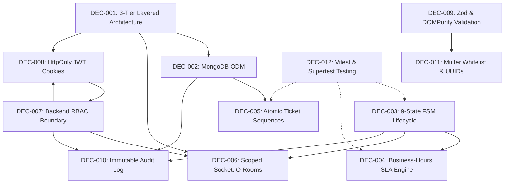

# Architecture & Project Decisions (DECISIONS.md)

**Project:** HelpDesk Hub (Enterprise ITSM & SLA Management System)  
**Maintained For:** Senior Engineers, AI Coding Agents, QA Engineers, Security Reviewers  
**Document Version:** 1.0.0  

---

## Purpose

This document preserves confirmed and intentional architectural, technical, security, data, API, infrastructure, and business-logic decisions for HelpDesk Hub. Its purpose is to ensure that future developers and autonomous AI coding agents do not repeatedly re-infer, contradict, or accidentally undo foundational decisions that were deliberately engineered.

---

## Rules for Future AI Agents

1. **Mandatory Pre-Flight Read:** Read this file before proposing, designing, or implementing any architecture-level changes.
2. **Treat "CONFIRMED" Decisions as Hard Constraints:** Never contradict or bypass a `CONFIRMED` decision without explicit human review and approval.
3. **No Silent Replacements:** Do not replace an established architectural pattern (e.g. FSM transitions, SLA business-hour logic, atomic sequence generation) with a naive or alternate pattern.
4. **Identify Conflicts First:** If a requested task appears to conflict with a decision in this registry, explicitly identify the conflict and ask for human clarification before modifying code.
5. **Preserve Rationale:** When updating or superseding a decision following approved human review, preserve the historical decision entry and clearly mark it as `SUPERSEDED` with cross-references.

---

## Decision Index

| ID | Decision Name | Status | Area |
| :--- | :--- | :---: | :--- |
| **DEC-001** | 3-Tier Layered Architecture with REST API & React SPA | CONFIRMED | Architecture |
| **DEC-002** | MongoDB 7.x with Mongoose ODM & Compound Indexing | CONFIRMED | Database |
| **DEC-003** | Finite State Machine (FSM) Lifecycle with 9 Discrete States | CONFIRMED | Business Logic |
| **DEC-004** | Mathematical Business-Hours SLA Engine with Paused Clock Mechanics | CONFIRMED | Business Logic |
| **DEC-005** | Concurrency-Safe Atomic Structured Ticket Sequencing (`HD-YYYY-XXXX`) | CONFIRMED | Database / Backend |
| **DEC-006** | Scoped WebSocket Room Topology with Private Internal Note Isolation | CONFIRMED | Real-Time / Security |
| **DEC-007** | Strict Backend-Enforced Role-Based Access Control (RBAC) | CONFIRMED | Security / Auth |
| **DEC-008** | JWT Authentication via HttpOnly, Secure, SameSite=Strict Cookies | CONFIRMED | Security / Auth |
| **DEC-009** | Dual-Layer Input Validation (Zod Schemas + DOMPurify Sanitization) | CONFIRMED | Security / API |
| **DEC-010** | Immutable Append-Only Forensic Audit Logging (`AuditLog` Collection) | CONFIRMED | Security / Compliance |
| **DEC-011** | Strict MIME Whitelisting & Cryptographic UUID File Upload Storage | CONFIRMED | Security / Storage |
| **DEC-012** | Vitest and Supertest Automated Testing with Ephemeral Instances | CONFIRMED | QA / Testing |

---

## Documented Architectural Decisions

### DEC-001 — 3-Tier Layered Architecture with REST API & React SPA
- **Status:** CONFIRMED
- **Date:** 2026-11-05
- **Area:** Architecture
- **Decision:** Build HelpDesk Hub as a decoupled 3-tier system: a client presentation tier (React 18 + Vite SPA, Tailwind CSS), an application & gateway tier (Express.js RESTful API v1 + Socket.IO server), and a data persistence tier (MongoDB 7.x cluster).
- **Why:** Separates concerns cleanly, enables independent scalability of frontend assets and backend API instances, and provides a clear API contract (`/api/v1`) for multiple client consumers.
- **Problem Solved:** Prevents tightly coupled monoliths where UI rendering and database queries intermingle, causing testing difficulties and performance bottlenecks.
- **Alternatives Considered:** Monolithic Server-Side Rendered (Next.js / SSR).
- **Why Alternatives Were Rejected:** The ITSM platform demands high-density, real-time interactive state management (Kanban drag-and-drop, dynamic ticket counters, live comment streams, real-time SLA countdowns) which is significantly cleaner and more performant as a decoupled SPA connected via WebSockets.
- **Constraints:** Requires CORS configuration and synchronized token management across HTTP and WS.
- **Impact:** Frontend build pipeline, Express route structure, API versioning.
- **Evidence:** `HelpDesk_Hub_Comprehensive_Documentation.md` (Chapter 2 & Chapter 10).
- **Change Risk:** Extreme. Changing this architecture breaks the entire client-server contract and deployment model.
- **Related Decisions:** DEC-006, DEC-008.

---

### DEC-002 — MongoDB 7.x with Mongoose ODM & Compound Indexing
- **Status:** CONFIRMED
- **Date:** 2026-11-05
- **Area:** Database
- **Decision:** Utilize MongoDB 7.x managed through Mongoose ODM, leveraging schema validation, embedded sub-documents for file attachments, and compound indexes for SLA query performance.
- **Why:** Ticket data in an ITSM system is semi-structured: tickets contain dynamic metadata, variable custom fields, arrays of attachments, and flexible comment histories. MongoDB natively accommodates document hierarchies while providing atomic counter operations and compound indexes.
- **Problem Solved:** Rigid relational schema migrations for evolving ticket taxonomies, slow join queries on large comment threads, and complex ORM mapping.
- **Alternatives Considered:** PostgreSQL with Prisma / TypeORM.
- **Why Alternatives Were Rejected:** Relational joins across deeply nested comments, file descriptors, and dynamic custom category fields add unnecessary ORM complexity. MongoDB's native JSON document model matches the REST and WebSocket JSON payloads seamlessly.
- **Constraints:** Requires careful indexing on `{ isBreached: 1, status: 1 }` and `{ requesterId: 1, createdAt: -1 }` to prevent full collection scans during background polling.
- **Impact:** All model definitions (`User.js`, `Ticket.js`, `Comment.js`, `AuditLog.js`, `Counter.js`).
- **Evidence:** `HelpDesk_Hub_Comprehensive_Documentation.md` (Chapter 7).
- **Change Risk:** Extreme. Database schema changes require full data migration and ORM refactoring.
- **Related Decisions:** DEC-005, DEC-010.

---

### DEC-003 — Finite State Machine (FSM) Lifecycle with 9 Discrete States
- **Status:** CONFIRMED
- **Date:** 2026-11-05
- **Area:** Business Logic
- **Decision:** Enforce a strict Finite State Machine with exactly 9 discrete ticket statuses: `New`, `Open`, `Assigned`, `In Progress`, `Pending User`, `Resolved`, `Closed`, `Reopened`, and `Cancelled`. Direct transitions are validated against a formal transition dictionary in `ticketService.js`.
- **Why:** Support tickets must follow a predictable, audited operational lifecycle. Preventing arbitrary status jumping ensures that technicians cannot close tickets without diagnostic notes, and employees cannot reopen closed tickets after the 48-hour acceptance window.
- **Problem Solved:** Inconsistent ticket states, orphaned tickets, untracked resolutions, and bypassed triage protocols.
- **Alternatives Considered:** Free-form status strings or simple 3-state models (Open, Pending, Closed).
- **Why Alternatives Were Rejected:** Fails enterprise ITSM governance (ITIL compliance), provides zero SLA clock visibility, and makes technician accountability impossible.
- **Constraints:** Any new status must have explicit authorized roles and defined automated side-effects in the transition matrix.
- **Impact:** `ticketService.js`, `Ticket.js`, frontend Kanban columns, SLA engine.
- **Evidence:** `HelpDesk_Hub_Comprehensive_Documentation.md` (Chapter 4).
- **Change Risk:** Critical. Altering valid state transitions breaks active workflows and frontend drag-and-drop behavior.
- **Related Decisions:** DEC-004, DEC-007.

---

### DEC-004 — Mathematical Business-Hours SLA Engine with Paused Clock Mechanics
- **Status:** CONFIRMED
- **Date:** 2026-11-05
- **Area:** Business Logic
- **Decision:** Calculate First Response and Resolution SLA targets based strictly on standard business hours (Monday to Friday, 09:00:00 to 18:00:00, 9 hours/day), skipping weekends and configured organization holidays. Crucially, when a ticket enters `Pending User`, the SLA clock is paused (`isSlaPaused = true`); when exiting, the paused duration is accumulated (`totalPausedDurationMs += delta`) and added to the effective deadline.
- **Why:** P1/P2/P3/P4 SLA contracts must reflect actual working hours. Charging technicians for SLA time while waiting on customer responses or over weekends unfairly distorts compliance metrics.
- **Problem Solved:** Inaccurate SLA breaches, unfair technician penalties, and distorted MTTR reports.
- **Alternatives Considered:** Simple wall-clock 24/7 countdown timer.
- **Why Alternatives Were Rejected:** Incompatible with corporate enterprise IT working schedules and ITIL service level management.
- **Constraints:** Requires a reliable background daemon running every 60 seconds to evaluate breaches and broadcast warnings at 75%-90% elapsed time.
- **Impact:** `slaEngine.js`, `slaPoller.js`, `Ticket.js`, `SLATimer.jsx`.
- **Evidence:** `HelpDesk_Hub_Comprehensive_Documentation.md` (Chapter 5).
- **Change Risk:** High. Modifying calculation algorithms causes historical metrics drift and false breach alerts.
- **Related Decisions:** DEC-003, DEC-006.

---

### DEC-005 — Concurrency-Safe Atomic Structured Ticket Sequencing (`HD-YYYY-XXXX`)
- **Status:** CONFIRMED
- **Date:** 2026-11-05
- **Area:** Database / Backend
- **Decision:** Implement human-readable ticket numbers formatted as `HD-YYYY-XXXX` (e.g. `HD-2026-0042`) generated atomically using MongoDB's `findOneAndUpdate({ $inc: { seq: 1 } }, { upsert: true, new: true })` on a dedicated `Counter` collection.
- **Why:** Raw MongoDB ObjectIDs (`65e9b8f1c2a1...`) are unreadable for employees and support phone conversations. Auto-incrementing counts using `Ticket.countDocuments()` suffer from race conditions under concurrent submissions.
- **Problem Solved:** Ticket number collisions under simultaneous submissions and unreadable identifier strings.
- **Alternatives Considered:** Client-generated UUIDs or `Ticket.countDocuments() + 1`.
- **Why Alternatives Were Rejected:** UUIDs are not human-friendly; counting documents produces identical duplicate IDs during concurrent ticket creations.
- **Constraints:** Requires database unique index on `Ticket.ticketNumber`.
- **Impact:** `sequenceService.js`, `Counter.js`, `ticketController.js`.
- **Evidence:** `HelpDesk_Hub_Comprehensive_Documentation.md` (Chapter 6).
- **Change Risk:** Medium. Changes to sequence formats must be backwards-compatible with existing ticket search.
- **Related Decisions:** DEC-002.

---

### DEC-006 — Scoped WebSocket Room Topology with Private Internal Note Isolation
- **Status:** CONFIRMED
- **Date:** 2026-11-05
- **Area:** Real-Time / Security
- **Decision:** Organize Socket.IO communication into scoped rooms (`user_<userId>`, `ticket_<ticketId>`, `role_technicians`, `role_admin`). Private internal diagnostic notes (`isInternal: true`) must NEVER be broadcasted to employee-facing rooms; they must be stripped before dispatch or broadcast exclusively to technician-restricted channels.
- **Why:** Real-time push updates eliminate tedious browser refreshes, but broadcasting raw database events risks leaking confidential diagnostics, credentials, or internal IT comments to end-user clients.
- **Problem Solved:** Confidentiality breaches where employees intercept technician-only troubleshooting notes over WebSocket streams.
- **Alternatives Considered:** Single global WebSocket channel with client-side filtering.
- **Why Alternatives Were Rejected:** Catastrophic security failure. Client-side filtering allows any user inspecting DevTools Network WS frames to read internal notes.
- **Constraints:** Sockets must verify user authentication during the handshake phase.
- **Impact:** `ticketSocket.js`, `commentController.js`, `CommentThread.jsx`.
- **Evidence:** `HelpDesk_Hub_Comprehensive_Documentation.md` (Chapter 8 & Chapter 11).
- **Change Risk:** High. Modifying room naming or event schemas breaks real-time updates across the frontend.
- **Related Decisions:** DEC-007, DEC-008.

---

### DEC-007 — Strict Backend-Enforced Role-Based Access Control (RBAC)
- **Status:** CONFIRMED
- **Date:** 2026-11-05
- **Area:** Security / Auth
- **Decision:** Enforce access control strictly in backend middleware (`rbacMiddleware.js`) and database query filters. Frontend UI component hiding (e.g. hiding the "Claim" button) is treated strictly as an ergonomic UX feature, never as a security boundary.
- **Why:** Attackers can trivially bypass UI restrictions by issuing raw HTTP requests via cURL or Postman.
- **Problem Solved:** Broken Object Level Authorization (BOLA/IDOR) and unauthorized privilege escalation.
- **Alternatives Considered:** Client-side role checking with generic backend controllers.
- **Why Alternatives Were Rejected:** Insecure by design; violates OWASP Top 10 A01:2021 (Broken Access Control).
- **Constraints:** Every mutating route must declare its authorized roles explicitly.
- **Impact:** All controllers, route definitions, and database queries.
- **Evidence:** `HelpDesk_Hub_Comprehensive_Documentation.md` (Chapter 3).
- **Change Risk:** Critical. Relaxing or altering RBAC middleware exposes private customer and system data.
- **Related Decisions:** DEC-008, DEC-010.

---

### DEC-008 — JWT Authentication via HttpOnly, Secure, SameSite=Strict Cookies
- **Status:** CONFIRMED
- **Date:** 2026-11-05
- **Area:** Security / Auth
- **Decision:** Store JSON Web Tokens (JWT) exclusively inside `HttpOnly`, `Secure`, `SameSite=Strict` cookies. Tokens are never stored in browser `localStorage` or `sessionStorage`.
- **Why:** LocalStorage is accessible to any JavaScript running on the page, making tokens vulnerable to theft via Cross-Site Scripting (XSS). HttpOnly cookies cannot be read by JavaScript.
- **Problem Solved:** Token theft and session hijacking via XSS vulnerabilities.
- **Alternatives Considered:** Bearer token in `localStorage` sent via `Authorization` header.
- **Why Alternatives Were Rejected:** Severe security risk. Any third-party script or XSS flaw can exfiltrate tokens from localStorage.
- **Constraints:** Requires CORS configuration with explicit `credentials: true` and locked origin.
- **Impact:** `authMiddleware.js`, `authController.js`, frontend Axios/fetch client configuration.
- **Evidence:** `HelpDesk_Hub_Comprehensive_Documentation.md` (Chapter 11).
- **Change Risk:** Critical. Altering cookie configuration can cause CSRF vulnerability or break cross-origin auth.
- **Related Decisions:** DEC-007, DEC-009.

---

### DEC-009 — Dual-Layer Input Validation (Zod Schemas + DOMPurify Sanitization)
- **Status:** CONFIRMED
- **Date:** 2026-11-05
- **Area:** Security / API
- **Decision:** Enforce a dual-layer input defense: validate structure, types, string lengths, and required fields using Zod schemas at the route entry; sanitize rich text and HTML descriptions using `DOMPurify` / `sanitize-html` before database persistence.
- **Why:** Protects against both schema tampering (NoSQL operator injection) and Stored Cross-Site Scripting (XSS) embedded in ticket descriptions or comments.
- **Problem Solved:** Database corruption, unhandled 500 crashes from unexpected payload types, and stored script execution.
- **Alternatives Considered:** Ad-hoc manual `if (!req.body.title)` checks.
- **Why Alternatives Were Rejected:** Fragile, error-prone, inconsistent across endpoints, and leaves parameter pollution vulnerabilities open.
- **Constraints:** Validation errors must return structured `400 Bad Request` messages detailing failing fields.
- **Impact:** `validators/*.js`, all controller functions.
- **Evidence:** `HelpDesk_Hub_Comprehensive_Documentation.md` (Chapter 9 & Chapter 11).
- **Change Risk:** Medium. Overly strict validation can reject legitimate inputs; lax validation introduces vulnerabilities.
- **Related Decisions:** DEC-007, DEC-011.

---

### DEC-010 — Immutable Append-Only Forensic Audit Logging (`AuditLog` Collection)
- **Status:** CONFIRMED
- **Date:** 2026-11-05
- **Area:** Security / Compliance
- **Decision:** Record all lifecycle events (ticket creation, status transitions, reassignments, priority changes, internal comments) in an immutable `AuditLog` collection. The API exposes zero `PUT`, `PATCH`, or `DELETE` endpoints for audit records; the ledger is strictly append-only.
- **Why:** Enterprise compliance, security incident forensics, and dispute resolution require an untamperable audit trail proving who performed an action, from what IP address, and at what exact timestamp.
- **Problem Solved:** Repudiation attacks where users or technicians deny altering ticket priorities or closing tickets.
- **Alternatives Considered:** Storing change history inside a mutable array on the `Ticket` document.
- **Why Alternatives Were Rejected:** Document size limits (16MB BSON limit), performance degradation on frequently updated tickets, and lack of forensic separation.
- **Constraints:** Audit logging must occur within the same transactional flow or service boundary as the state mutation.
- **Impact:** `auditService.js`, `AuditLog.js`, `auditController.js`.
- **Evidence:** `HelpDesk_Hub_Comprehensive_Documentation.md` (Chapter 7 & Chapter 11).
- **Change Risk:** High. Corrupting audit records violates compliance standards.
- **Related Decisions:** DEC-003, DEC-007.

---

### DEC-011 — Strict MIME Whitelisting & Cryptographic UUID File Upload Storage
- **Status:** CONFIRMED
- **Date:** 2026-11-05
- **Area:** Security / Storage
- **Decision:** Process file uploads using Multer with strict MIME whitelisting (`application/pdf`, `image/png`, `image/jpeg`, `text/plain`, `text/csv`). Files are renamed to cryptographically random UUIDs (`uuidv4() + ext`) and stored outside the public document root.
- **Why:** User-provided filenames frequently contain path traversal characters (`../../`) or disguised executable extensions (`shell.php.png`).
- **Problem Solved:** Arbitrary file upload, remote code execution (RCE) via web shells, and server disk traversal.
- **Alternatives Considered:** Retaining original filenames and serving directly from public directory.
- **Why Alternatives Were Rejected:** Extreme vulnerability. Allows direct script execution by requesting uploaded web shells.
- **Constraints:** Maximum upload file size enforced at 5MB for employees, 10MB for technicians, 25MB for administrators.
- **Impact:** `uploadMiddleware.js`, `ticketController.js`.
- **Evidence:** `HelpDesk_Hub_Comprehensive_Documentation.md` (Chapter 11).
- **Change Risk:** High. Misconfiguring MIME filters can break screenshot uploads or admit malicious scripts.
- **Related Decisions:** DEC-009.

---

### DEC-012 — Vitest and Supertest Automated Testing with Ephemeral Instances
- **Status:** CONFIRMED
- **Date:** 2026-11-05
- **Area:** QA / Testing
- **Decision:** Standardize automated testing on **Vitest** for fast unit/integration testing and **Supertest** for HTTP API verification against an ephemeral in-memory MongoDB instance (`mongodb-memory-server`).
- **Why:** Fast execution, native ESM and TypeScript/JSX support, seamless Vite integration, and zero cross-test state pollution due to isolated database cleanup between test runs.
- **Problem Solved:** Flaky tests, slow test runs, and test pollution caused by shared persistent databases.
- **Alternatives Considered:** Jest with full external MongoDB instance.
- **Why Alternatives Were Rejected:** Jest configuration with ESM and Vite requires cumbersome Babel transpilation; external databases make CI pipelines brittle and state-dependent.
- **Constraints:** Tests must clean up collections in `afterEach` or `afterAll` hooks.
- **Impact:** `server/tests/*`, `package.json`.
- **Evidence:** `HelpDesk_Hub_Comprehensive_Documentation.md` (Chapter 12).
- **Change Risk:** Low to codebase, High to CI reliability.
- **Related Decisions:** DEC-001, DEC-002.

---

## Decision Dependency Analysis

The architectural decisions form a tightly interwoven dependency graph:

- **Changing DEC-001 (Architecture)** requires reviewing all decisions.
- **Changing DEC-003 (FSM Lifecycle)** directly impacts DEC-004 (SLA Engine), DEC-006 (Sockets), and DEC-010 (Audit Log).
- **Changing DEC-007 (RBAC)** requires reviewing DEC-006 (Sockets privacy) and DEC-008 (JWT Cookies).

---

## Change Protocol for Future Agents

Before making any change that touches an established architectural decision:
1. **Locate the Decision:** Identify the corresponding `DEC-XXX` identifier in this registry.
2. **Review Rationale & Constraints:** Understand *why* the choice was made and what problems it solved.
3. **Analyze Impact Map:** Cross-reference `IMPACT-MAP.md` to identify affected files and consumers.
4. **Identify Dependent Decisions:** Trace dependencies in the Decision Dependency graph above.
5. **Formulate Justification:** Clearly explain why the current decision no longer fits project requirements.
6. **Obtain Explicit Human Approval:** Present the proposed change, impact analysis, and rollback strategy to the user.
7. **Post-Approval Update:** Update code first, then update this document marking the old decision as `SUPERSEDED` and adding the new decision with full rationale.

---

## Final Validation

- All 12 decisions have verified evidence in `HelpDesk_Hub_Comprehensive_Documentation.md`.
- No decision contains fabricated rationale or undocumented assumptions.
- IDs are permanently stable (`DEC-001` through `DEC-012`).
- No source code was modified during this documentation process.
