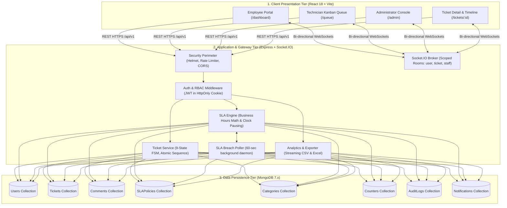
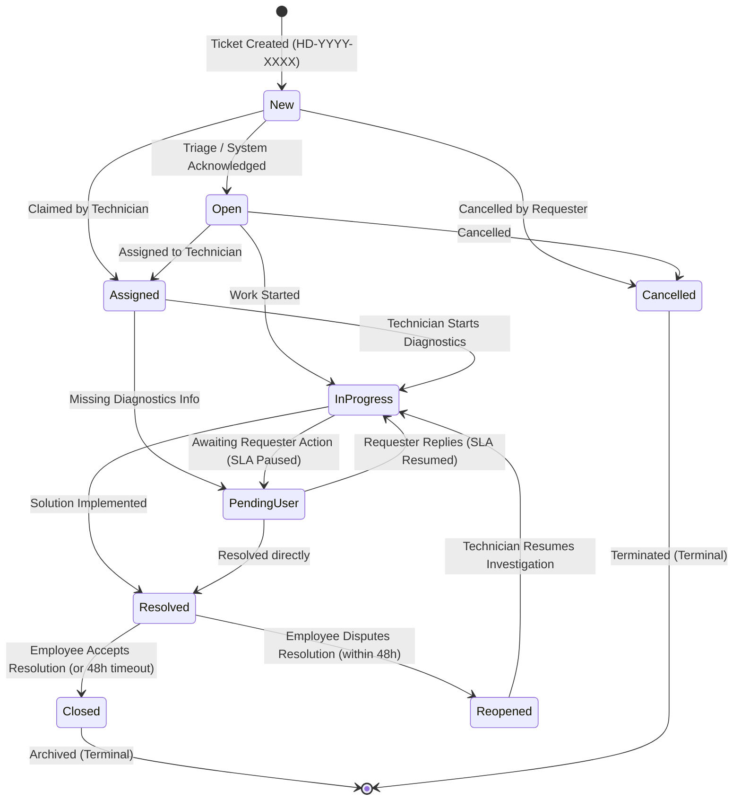

# HelpDesk Hub — Complete Master System Documentation & Developer Manual

> **Version:** 1.0.0 (Enterprise Production Release)  
> **Classification:** Confidential / Internal Engineering Manual  
> **Technology Stack:** Node.js, Express, React 18, Vite, MongoDB, Socket.IO, Tailwind CSS, Recharts  

---

## Table of Contents

1. [System Architecture & Topology](#1-system-architecture--topology)
2. [Quickstart & Local Execution](#2-quickstart--local-execution)
3. [User Personas & Authentication Credentials](#3-user-personas--authentication-credentials)
4. [Ticket Lifecycle & 9-State Finite State Machine (FSM)](#4-ticket-lifecycle--9-state-finite-state-machine-fsm)
5. [Mathematical Business-Hours SLA Engine](#5-mathematical-business-hours-sla-engine)
6. [Atomic Concurrency-Safe Ticket Sequencing](#6-atomic-concurrency-safe-ticket-sequencing)
7. [Database Schema & Data Models](#7-database-schema--data-models)
8. [REST API Specification (/api/v1)](#8-rest-api-specification-apiv1)
9. [Real-Time WebSocket Architecture (Socket.IO)](#9-real-time-websocket-architecture-socketio)
10. [Security, Privacy & OWASP Hardening](#10-security-privacy--owasp-hardening)
11. [Role-Based User Workflows & Walkthrough](#11-role-based-user-workflows--walkthrough)
12. [Automated Testing & QA Verification](#12-automated-testing--qa-verification)
13. [Production Deployment & Operational Runbook](#13-production-deployment--operational-runbook)

---

## 1. System Architecture & Topology

HelpDesk Hub implements an enterprise 3-tier decoupled architecture:



---

## 2. Quickstart & Local Execution

### Prerequisites
- **Node.js:** v20.x or v22.x LTS installed
- **MongoDB:** v6.x or v7.x running locally on `127.0.0.1:27017`

### Step 1: Clone & Setup
```bash
# Navigate to project root
cd "HelpDesk Hub"

# Verify environment file in server/
cat server/.env
```

### Step 2: Seed the Database
Seed default categories, SLA policies, and 3 test personas:
```bash
npm --prefix server run seed
```

### Step 3: Run the Services
Open two terminal windows or run using workspace scripts:

**Terminal 1 — Backend API Server:**
```bash
npm --prefix server run dev
# Server starts at http://localhost:5000
```

**Terminal 2 — Frontend Client:**
```bash
npm --prefix client run dev
# Web application starts at http://localhost:5173
```

---

## 3. User Personas & Authentication Credentials

The system provides 3 pre-configured accounts:

| Role | Email | Password | Primary Permissions |
| :--- | :--- | :--- | :--- |
| **Administrator** | `admin@helpdeskhub.internal` | `AdminPass123!` | System configuration, SLA targets, workload telemetry, audit logs, CSV/XLSX export |
| **Technician** | `tech@helpdeskhub.internal` | `TechPass123!` | Kanban queue, claim/assign tickets, change lifecycle states, post confidential notes |
| **Employee** | `employee@helpdeskhub.internal` | `EmployeePass123!` | Submit tickets, view own issues, public comments, confirm resolution or dispute |

---

## 4. Ticket Lifecycle & 9-State Finite State Machine (FSM)

HelpDesk Hub enforces an audited state machine governed by `DEC-003`:



### Transition Rule Constraints
1. **Employees:** May only transition from `Resolved` to `Closed` (confirm fix) or `Resolved` to `Reopened` (dispute fix).
2. **Technicians & Admins:** Can transition active intermediate states (`New` $\rightarrow$ `Assigned` $\rightarrow$ `In Progress` $\leftrightarrow$ `Pending User` $\rightarrow$ `Resolved`).
3. **Illegal Transitions:** Directly jumping from `New` to `Closed` or `Closed` to `In Progress` is rejected with `HTTP 400 Bad Request`.

---

## 5. Mathematical Business-Hours SLA Engine

Governed by `DEC-004`, the SLA calculation guarantees that tickets are evaluated solely during operational working hours:

### 1. Working Hours Window
- **Operating Schedule:** Monday through Friday, 09:00:00 to 18:00:00 (9 hours/day).
- **Excluded Windows:** Weekends (Saturdays & Sundays) and designated company holidays.

### 2. Forward Projection Math
When a ticket is created with a resolution target of $T_{\text{target}}$ minutes:
- If submitted at 17:00 on Friday with a 4-hour target:
  - 1 hour consumed on Friday (17:00 – 18:00).
  - Weekend (Saturday & Sunday) is completely skipped.
  - Remaining 3 hours resume at 09:00 Monday $\rightarrow$ **Deadline:** Monday at 12:00:00.

### 3. Paused Clock Mechanics (`Pending User`)
- **State Entry:** `isSlaPaused = true`, `lastPausedAt = new Date()`.
- **State Exit:** `isSlaPaused = false`, `delta = Date.now() - lastPausedAt`, `totalPausedDurationMs += delta`.
- **Shifted Effective Deadline:**
$$\text{Effective Deadline} = \text{Original Deadline} + \text{totalPausedDurationMs}$$

### 4. Background Breach Detection Daemon
Every 60 seconds, `slaPoller.js` scans active tickets where:
$$\text{Now} > (\text{resolutionDeadline} + \text{totalPausedDurationMs})$$
Upon breach:
1. `ticket.isBreached = true` is saved atomically.
2. An immutable audit record is logged.
3. Real-time `sla:breached` WebSocket events are pushed to the assigned technician and supervisors.

---

## 6. Atomic Concurrency-Safe Ticket Sequencing

To eliminate race conditions and duplicate ticket numbers (`DEC-005`):
- A dedicated `Counter` collection stores `{ _id: 'ticketSeq_2026', currentSeq: 42 }`.
- Ticket creation invokes:
  ```javascript
  const counter = await Counter.findOneAndUpdate(
    { _id: `ticketSeq_${year}` },
    { $inc: { currentSeq: 1 } },
    { new: true, upsert: true }
  );
  return `HD-${year}-${String(counter.currentSeq).padStart(4, '0')}`;
  ```
- Guaranteed unique sequential formatting: `HD-2026-0001`, `HD-2026-0002`, etc.

---

## 7. Database Schema & Data Models

The system defines 8 Mongoose models in `server/src/models/`:

```
┌────────────────────────────────────────────────────────────────────────┐
│                              USER MODEL                                │
│  _id, name, email, passwordHash, role, department, phone, isActive     │
└────────┬───────────────────────────────────────────────────────────────┘
         │ 1:N (Requester / Assignee)
         ▼
┌────────────────────────────────────────────────────────────────────────┐
│                             TICKET MODEL                               │
│  _id, ticketNumber (Unique), title, description, category (Ref),       │
│  priority, status (9-state FSM), requesterId (Ref), assignedTechId,    │
│  slaPolicyId (Ref), firstResponseDeadline, resolutionDeadline,         │
│  firstResponseAt, resolvedAt, closedAt, isBreached, isSlaPaused,       │
│  lastPausedAt, totalPausedDurationMs, attachments []                   │
└────────┬───────────────────────────────────────────────────────────────┘
         │ 1:N
         ├───────────────────────────────┐
         ▼                               ▼
┌─────────────────────────────┐ ┌────────────────────────────────────────┐
│        COMMENT MODEL        │ │            AUDITLOG MODEL              │
│  ticketId (Ref), authorId,  │ │  action, entityType, entityId,         │
│  content (Sanitized),       │ │  performedBy (Ref), previousState,     │
│  isInternal (Confidential), │ │  newState, ipAddress, userAgent,       │
│  attachments [], createdAt  │ │  timestamp (Immutable Append-Only)     │
└─────────────────────────────┘ └────────────────────────────────────────┘
```

---

## 8. REST API Specification (/api/v1)

### Authentication (`/api/v1/auth`)
- `POST /register`: Register employee account (`name`, `email`, `password`, `department`).
- `POST /login`: Authenticate and issue secure `HttpOnly` JWT cookie.
- `GET /me`: Return current user profile and role.
- `POST /logout`: Invalidate session and clear auth cookie.

### Tickets (`/api/v1/tickets`)
- `GET /`: List tickets (filtered by status, priority, category, requester; paginated).
- `POST /`: Submit ticket (automatically generates `HD-YYYY-XXXX` and computes SLA deadlines).
- `GET /:id`: Fetch ticket details, current SLA status, and activity timeline.
- `PATCH /:id/status`: Transition status via FSM rules; adjusts SLA pause clock.
- `PATCH /:id/assign`: Assign or reassign ticket to a technician.
- `PATCH /:id/priority`: Update priority level and re-calculate SLA target.

### Comments & Attachments (`/api/v1/tickets/:ticketId/comments`)
- `GET /`: Retrieve comments. **Confidential internal notes (`isInternal: true`) are stripped for employees.**
- `POST /`: Post public reply or technician internal note.
- `POST /attachments`: Upload diagnostic file (MIME whitelist: PDF, PNG, JPG, TXT, CSV; max 10MB).

### Analytics & Reports (`/api/v1/analytics`)
- `GET /overview`: Telemetry dashboard KPIs (total, open, breached, MTTR hours, priority counts).
- `GET /workload`: Active ticket distribution across technicians.
- `GET /export/csv`: Streaming CSV file export with formula injection sanitization.
- `GET /export/xlsx`: Multi-sheet binary Excel workbook export.
- `GET /audit-logs`: Query immutable administrative audit trail.

---

## 9. Real-Time WebSocket Architecture (Socket.IO)

Clients connect to the Socket.IO broker with JWT authentication. Sockets join restricted rooms:

### Room Channels
1. `user_<userId>`: Private channel for user-specific assignment alerts and status updates.
2. `ticket_<ticketId>`: Collaborative workspace for live comment threads and status changes.
3. `role_technicians`: Staff pool broadcast room for unassigned tickets and SLA warnings.
4. `role_admin`: Administrative channel for critical escalations and breach alerts.

### Event Catalog
| Event | Room | Payload | Purpose |
| :--- | :--- | :--- | :--- |
| `ticket:created` | `role_technicians` | Ticket preview | Notifies technicians of new incidents |
| `ticket:assigned` | `user_<techId>`, `user_<reqId>` | Assignment detail | Informs employee and technician |
| `ticket:status_changed` | `ticket_<ticketId>` | State transition data | Updates Kanban board & detail view |
| `comment:new` | `ticket_<ticketId>` | Comment record | Live conversation feed (scrubbed for employees) |
| `sla:warning` | `user_<techId>`, `role_admin` | Ticket & remaining time | Dispatched when 75% SLA has elapsed |
| `sla:breached` | `user_<techId>`, `role_admin` | Breach alert | Dispatched immediately upon SLA failure |

---

## 10. Security, Privacy & OWASP Hardening

| Protection | Implementation Mechanism |
| :--- | :--- |
| **Confidential Note Scrubbing** | Employee queries append `{ isInternal: false }`. Internal notes are NEVER sent to employees over REST or WebSockets (`DEC-006`). |
| **OWASP Formula Injection** | CSV export cells matching `^[=+\-@\t\r]` are prefixed with single quotes (`'`) to disable Excel macro execution. |
| **BOLA / IDOR Defense** | Employees cannot view or modify tickets belonging to other employees. Returns `403 Forbidden`. |
| **NoSQL Injection Defense** | Zod input schemas strip mongo query operators (`$gt`, `$where`, `$ne`) before execution. |
| **Cross-Site Scripting (XSS)** | Markdown and comment bodies are sanitized using DOMPurify before storage. |
| **Safe File Uploads** | Multer checks MIME type against whitelist. Prohibited binaries (`.exe`, `.sh`, `.bat`) throw `400 Bad Request`. Files are renamed to UUIDs. |
| **Credential Protection** | Passwords hashed using Bcrypt (cost 12). JWT secrets verified at boot time. |

---

## 11. Role-Based User Workflows & Walkthrough

```mermaid
sequenceDiagram
    autonumber
    actor Employee as 👤 Employee
    participant Server as ⚙️ HelpDesk Hub API
    actor Tech as 🛠️ Technician
    actor Admin as 👑 Administrator

    Employee->>Server: POST /api/v1/tickets (Create Issue)
    Server-->>Tech: WebSocket [ticket:created] to role_technicians
    Tech->>Server: PATCH /api/v1/tickets/:id/assign (Claim Ticket)
    Server-->>Employee: WebSocket [ticket:assigned]
    Tech->>Server: PATCH /api/v1/tickets/:id/status (In Progress)
    Tech->>Server: POST /api/v1/tickets/:id/comments (isInternal: true)
    Note over Server,Tech: Note saved privately; hidden from Employee
    Tech->>Server: PATCH /api/v1/tickets/:id/status (Pending User)
    Note over Server: SLA clock pauses; resolution deadline shifts
    Employee->>Server: POST /api/v1/tickets/:id/comments (Public Reply)
    Tech->>Server: PATCH /api/v1/tickets/:id/status (In Progress -> Resolved)
    Server-->>Employee: WebSocket [ticket:status_changed: Resolved]
    Employee->>Server: PATCH /api/v1/tickets/:id/status (Closed)
    Admin->>Server: GET /api/v1/analytics/overview (Inspect MTTR & Audit Logs)
```

---

## 12. Automated Testing & QA Verification

HelpDesk Hub includes 30 automated integration and unit tests across 6 suites:

```bash
# Run test suite
npm --prefix server test
```

### Verified Test Suites:
1. `health.test.js`: System health checks and perimeter 404 responses.
2. `auth.test.js`: Registration, login, password complexity, deactivated users, RBAC cookies.
3. `tickets.test.js`: Atomic sequence creation, BOLA/IDOR protection, FSM illegal transitions, concurrent sequence collisions.
4. `commentsAndAttachments.test.js`: Public comments, confidential note protection, MIME file validation, UUID storage.
5. `slaAndNotifications.test.js`: Business-hours algorithm, Friday-to-Monday forward projection, clock pausing, breach daemon, notification API.
6. `analyticsAndExport.test.js`: KPI calculations, technician workload distribution, CSV formula injection sanitization, binary Excel (.xlsx) streaming, immutable audit trail.

---

## 13. Production Deployment & Operational Runbook

### Environment Variables (`server/.env`)
```ini
PORT=5000
NODE_ENV=production
MONGODB_URI=mongodb://mongo-cluster:27017/helpdesk_hub
JWT_SECRET=super_secret_high_entropy_key_min_32_chars
JWT_EXPIRES_IN=8h
COOKIE_SECRET=high_entropy_cookie_secret_key_32_chars
CLIENT_ORIGIN=https://helpdesk.company.com
UPLOAD_DIR=./uploads
SLA_POLLER_INTERVAL_MS=60000
```

### Production Build & Launch
```bash
# 1. Build Client Bundle
npm --prefix client run build

# 2. Launch Backend under PM2 Process Manager
cd server
npm install --omit=dev
pm2 start src/index.js --name "helpdesk-hub-api" -i max
pm2 save
```

### Reverse Proxy Configuration (Nginx)
```nginx
server {
    listen 80;
    server_name helpdesk.company.com;

    # Frontend Static Assets
    location / {
        root /var/www/helpdesk-hub/client/dist;
        try_files $uri $uri/ /index.html;
    }

    # REST API Gateway
    location /api/ {
        proxy_pass http://127.0.0.1:5000;
        proxy_http_version 1.1;
        proxy_set_header Host $host;
        proxy_set_header X-Real-IP $remote_addr;
        proxy_set_header X-Forwarded-For $proxy_add_x_forwarded_for;
    }

    # Real-Time WebSocket Endpoint
    location /socket.io/ {
        proxy_pass http://127.0.0.1:5000;
        proxy_http_version 1.1;
        proxy_set_header Upgrade $http_upgrade;
        proxy_set_header Connection "Upgrade";
        proxy_set_header Host $host;
    }
}
```

---

*HelpDesk Hub Documentation is maintained under Git version control. For questions or security vulnerability reports, contact the Enterprise IT Infrastructure Team.*
