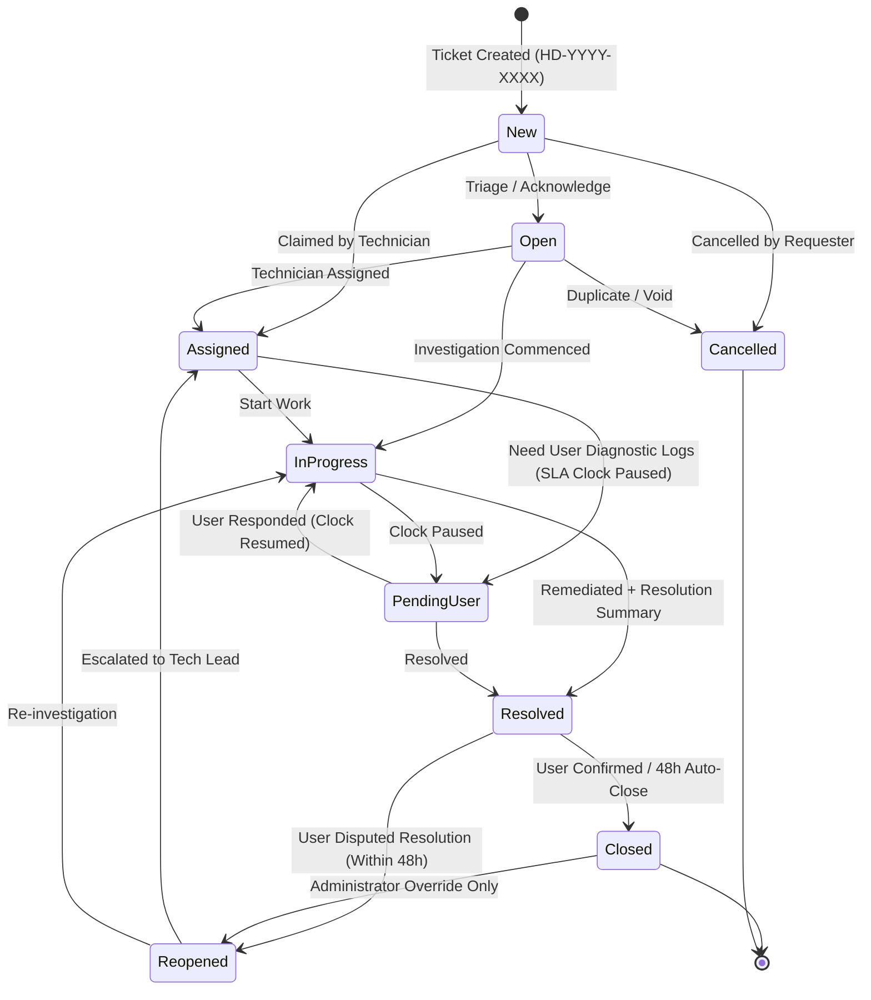

# HelpDesk Hub — Enterprise IT Help Desk & SLA Management Platform

[](https://nodejs.org/)
[](https://react.dev/)
[](https://www.mongodb.com/)
[](https://tailwindcss.com/)
[](https://vitest.dev/)
[](https://opensource.org/licenses/MIT)

**HelpDesk Hub** is a full-lifecycle, production-ready IT Help Desk & Service Management platform engineered to replace informal support email chains with an automated, audited, and mathematically accurate SLA ticketing engine. It bridges end-user technical difficulties with Level 1/2/3 technicians and supervisory administration through real-time push events, granular role-based authorization (RBAC), strict finite state machine (FSM) transitions, and concurrency-safe data persistence.

---

## Table of Contents

1. [Executive Summary & Capabilities](#1-executive-summary--capabilities)
2. [Technology Stack](#2-technology-stack)
3. [User Roles & RBAC Matrix](#3-user-roles--rbac-matrix)
4. [Ticket Lifecycle & 9-State Finite State Machine](#4-ticket-lifecycle--9-state-finite-state-machine)
5. [Mathematical Business-Hours SLA Engine](#5-mathematical-business-hours-sla-engine)
6. [Concurrency-Safe Atomic Ticket Numbering](#6-concurrency-safe-atomic-ticket-numbering)
7. [Directory Structure](#7-directory-structure)
8. [Installation & Setup Guide](#8-installation--setup-guide)
9. [Environment Configuration](#9-environment-configuration)
10. [Database Seeder & Test Personas](#10-database-seeder--test-personas)
11. [REST API Documentation (/api/v1)](#11-rest-api-documentation-apiv1)
12. [Automated Testing & QA Verification](#12-automated-testing--qa-verification)
13. [Production Deployment Architecture](#13-production-deployment-architecture)

---

## 1. Executive Summary & Capabilities

- **Mathematical SLA Governance:** Projects response and resolution targets strictly across standard working hours (09:00 - 18:00, Mon-Fri), skipping weekends and organization holidays. Dynamically pauses the SLA clock when a ticket enters `Pending User` and resumes upon customer reply.
- **Race-Condition-Free Sequences:** Implements atomic MongoDB counters generating sequential identifiers formatted as `HD-YYYY-XXXX` (e.g. `HD-2026-0001`).
- **Private Internal Diagnostic Notes:** Protects confidential troubleshooting logs and credentials (`isInternal: true`) from ever reaching employee screens via REST query projection or WebSocket room partitioning.
- **Scoped Real-Time Event Stream:** Socket.IO architecture utilizing private user rooms (`user_<id>`), active ticket rooms (`ticket_<id>`), and staff broadcast pools (`role_technicians`).
- **Immutable Forensic Audit Ledger:** Append-only event history capturing state transitions, assignments, IP addresses, and timestamps with zero modification routes.

---

## 2. Technology Stack

### Frontend presentation layer
- **React 18** Single-Page Application (SPA)
- **Vite** build tooling and hot-module replacement
- **React Router v6** client-side route guards
- **Tailwind CSS** with dark/light theme switching
- **Recharts** interactive KPI telemetry charts
- **Socket.IO Client** bi-directional real-time push notifications
- **Lucide Icons** accessible enterprise UI icons

### Backend gateway & real-time tier
- **Node.js LTS (v20+)** runtime
- **Express.js** RESTful API Gateway under `/api/v1`
- **Socket.IO Server** state-synchronized WebSocket broker
- **Bcrypt.js** (Salt work factor 12) password hashing
- **JSON Web Tokens (JWT)** issued in `HttpOnly`, `SameSite=Strict`, `Secure` cookies
- **Zod** strict request body, parameter, and query schema validation
- **Multer** MIME-whitelisted diagnostic file upload engine
- **Helmet & Express-Rate-Limit** perimeter security headers and throttling
- **ExcelJS & Csv-Stringify** streaming analytical report exporters

### Data persistence tier
- **MongoDB 7.x** document database
- **Mongoose ODM** with compound indexing and atomic counter operators

---

## 3. User Roles & RBAC Matrix

| Functional Capability | Employee (Requester) | Technician (Resolver) | Administrator (Supervisor) |
| :--- | :---: | :---: | :---: |
| **Create Ticket** | Allowed (Self) | Allowed (On Behalf) | Allowed (Full) |
| **View Own Tickets** | Allowed | Allowed | Allowed |
| **View All Departments / Queue** | Denied (403) | Allowed | Allowed |
| **Claim / Self-Assign Ticket** | Denied (403) | Allowed | Allowed (Any Tech) |
| **Modify Ticket Priority** | Denied (403) | Allowed | Allowed |
| **Transition Intermediate Status** | Denied (403) | Allowed | Allowed |
| **Accept Resolution (Close)** | Allowed (Own) | Allowed | Allowed |
| **Dispute Resolution (Reopen 48h)**| Allowed (Own) | Allowed | Allowed |
| **Add Public Comments** | Allowed | Allowed | Allowed |
| **Add / View Private Internal Notes**| Denied (Scrubbed) | Allowed | Allowed |
| **Upload Diagnostic Files** | Allowed (Max 10MB) | Allowed (Max 10MB) | Allowed (Max 25MB) |
| **Configure Categories & SLAs** | Denied (403) | Denied (403) | Allowed |
| **Inspect System Audit Logs** | Denied (403) | Denied (403) | Allowed |
| **Export CSV / Excel Telemetry** | Denied (403) | Denied (403) | Allowed |

---

## 4. Ticket Lifecycle & 9-State Finite State Machine



---

## 5. Mathematical Business-Hours SLA Engine

- **Default Schedule:** Monday through Friday, 09:00:00 to 18:00:00 (9 working hours/day).
- **Forward Calendar Projection:** Tickets submitted after-hours or on weekends advance to 09:00:00 of the next working day. A P2 ticket (8 business hours target) logged Friday at 16:00 receives 2 hours of credit on Friday and completes Monday at 15:00:00.
- **Clock Pausing Mechanics:**
  - `ticket.isSlaPaused = true; ticket.lastPausedAt = new Date();`
  - When resumed: `totalPausedDurationMs += (Date.now() - ticket.lastPausedAt);`
  - Deadlines automatically push forward: `resolutionDeadline += pausedDeltaMs`.
- **Automated Breach Poller:** Periodic worker executes every 60 seconds. Active tickets passing `resolutionDeadline` are flagged `isBreached: true` with instant alerts pushed to all connected technicians.

---

## 6. Concurrency-Safe Atomic Ticket Numbering

Under simultaneous submissions, standard count queries (`countDocuments() + 1`) generate identical IDs. HelpDesk Hub executes atomic increments on an isolated `counters` collection:

```javascript
const counter = await Counter.findOneAndUpdate(
  { _id: `ticketSeq_${currentYear}` },
  { $inc: { currentSeq: 1 } },
  { new: true, upsert: true }
);
const ticketNumber = `HD-${currentYear}-${String(counter.currentSeq).padStart(4, '0')}`;
```
Verified in automated stress test: 10 simultaneous ticket submissions produce 10 consecutive, non-colliding IDs.

---

## 7. Directory Structure

```
helpdesk-hub/
├── server/
│   ├── src/
│   │   ├── config/            # Database connection, env loader, constants
│   │   ├── controllers/       # HTTP request handlers (auth, ticket, comment, analytics, sla)
│   │   ├── models/            # Mongoose schemas (User, Ticket, Comment, SLAPolicy, AuditLog)
│   │   ├── services/          # Business logic (ticketService, slaEngine, sequenceService)
│   │   ├── middleware/        # JWT auth, RBAC guards, rate limiter, multer uploads, error handler
│   │   ├── validators/        # Zod validation schemas
│   │   ├── sockets/           # Socket.IO connection and room broker
│   │   ├── utils/             # Business hours math, logger, seed script
│   │   ├── server.js          # Express application setup
│   │   └── index.js           # HTTP and Socket.IO entrypoint
│   ├── tests/                 # Vitest and Supertest automated test suites
│   ├── uploads/               # Encrypted UUID diagnostic attachments
│   └── package.json
│
├── client/
│   ├── src/
│   │   ├── components/        # Common primitives, layout, Kanban board, SLA timers
│   │   ├── context/           # AuthContext, SocketContext, ThemeContext, ToastContext
│   │   ├── pages/             # EmployeeDashboard, TechQueue, AdminConsole, TicketDetail
│   │   ├── services/          # Axios HTTP client instance
│   │   ├── App.jsx            # Router and role-based route guards
│   │   └── main.jsx
│   ├── tailwind.config.js
│   ├── vite.config.js
│   └── package.json
│
├── security/                  # Threat model, secrets guide, attack surface, checklist
├── DECISIONS.md               # 12 confirmed architectural decisions and change protocol
├── IMPACT-MAP.md              # Component ripple map and verification checklist
├── GITHUB_REPOSITORIES.md     # 10 Claude/AI viral repos and QA testing stack
└── package.json               # Root monorepo workspace scripts
```

---

## 8. Installation & Setup Guide

### Prerequisites
- **Node.js LTS:** v20.x or v22.x
- **MongoDB:** v7.x running locally on port 27017 (or MongoDB Atlas URI)
- **Git**

### Step 1: Clone Repository
```bash
git clone https://github.com/your-org/helpdesk-hub.git
cd helpdesk-hub
```

### Step 2: Install Dependencies
```bash
# Install backend dependencies
cd server
npm install

# Install frontend dependencies
cd ../client
npm install
cd ..
```

### Step 3: Configure Environment
Copy `.env.example` in `server/`:
```bash
cp server/.env.example server/.env
```

### Step 4: Seed Database with Enterprise Fixtures
Populates default IT categories, SLA policies, test accounts, and sample tickets:
```bash
cd server
npm run seed
cd ..
```

### Step 5: Start Development Servers
In two separate terminal windows:
```bash
# Terminal 1: Backend API & WebSocket Server (Port 5050)
npm run dev:server

# Terminal 2: Frontend Vite React Application (Port 3000)
npm run dev:client
```
Navigate your browser to `http://localhost:3000`.

---

## 9. Environment Configuration

### Server Environment Variables (`server/.env`)
| Variable | Default Value | Description |
| :--- | :--- | :--- |
| `PORT` | `5050` | HTTP and WebSocket server listening port. |
| `NODE_ENV` | `development` | Environment mode (`development`, `test`, `production`). |
| `MONGODB_URI` | `mongodb://127.0.0.1:27017/helpdesk_hub` | Connection string for MongoDB database. |
| `JWT_SECRET` | *(64-char high-entropy string)* | Symmetric secret for signing authorization JWTs. |
| `JWT_EXPIRES_IN`| `8h` | Lifetime of issued authentication tokens. |
| `COOKIE_SECRET` | *(32-char high-entropy string)* | Secret used for cookie signature verification. |
| `CLIENT_ORIGIN` | `http://localhost:3000` | Authorized CORS origin for web requests and WebSockets. |
| `UPLOAD_DIR` | `./uploads` | Storage directory for diagnostic attachments. |

---

## 10. Database Seeder & Test Personas

When running `npm run seed` in `server/`, the following seed personas are ready for login:

| Persona | Email | Password | Role / Access Scope |
| :--- | :--- | :--- | :--- |
| **IT Director** | `admin@helpdeskhub.internal` | `AdminPass123!` | Full supervisory access, analytics, export, audit log. |
| **Senior Tech** | `tech@helpdeskhub.internal` | `TechPass123!` | Operational Kanban queue, internal notes, status transitions. |
| **Employee** | `employee@helpdeskhub.internal` | `EmployeePass123!` | Requester dashboard, new ticket submission, resolution review. |

---

## 11. REST API Documentation (/api/v1)

### Authentication Endpoints
- `POST /api/v1/auth/register` — Register new employee account.
- `POST /api/v1/auth/login` — Authenticate and receive HttpOnly cookie.
- `GET /api/v1/auth/me` — Return current session profile and role.
- `POST /api/v1/auth/logout` — Invalidate session and clear auth cookie.

### Ticket Lifecycle Endpoints
- `GET /api/v1/tickets` — Paginated ticket list with status, priority, and search filters.
- `POST /api/v1/tickets` — Create new incident; generates atomic `HD-YYYY-XXXX` ID.
- `GET /api/v1/tickets/:id` — Retrieve full ticket details and SLA status (enforces BOLA).
- `PATCH /api/v1/tickets/:id/status` — Advance FSM state and recalculate SLA clock.
- `PATCH /api/v1/tickets/:id/assign` — Assign or reassign technician (`Technician`, `Admin`).
- `PATCH /api/v1/tickets/:id/priority` — Adjust priority and recalculate SLA targets.

### Comments & Attachment Endpoints
- `GET /api/v1/tickets/:id/comments` — Threaded comments (strips internal notes for employees).
- `POST /api/v1/tickets/:id/comments` — Append public comment or private internal note.
- `GET /api/v1/tickets/:id/comments/timeline` — Chronological audit activity stream.
- `POST /api/v1/tickets/:id/comments/attachments` — Upload diagnostic screenshots/logs.

### Administrative & Reporting Endpoints
- `GET /api/v1/analytics/overview` — Aggregated KPIs: MTTR, breach rate, priority distribution.
- `GET /api/v1/analytics/workload` — Active technician workload distribution.
- `GET /api/v1/analytics/export/csv` — Stream CSV export (sanitizes formula injection).
- `GET /api/v1/analytics/export/xlsx` — Generate multi-sheet formatted Excel workbook.
- `GET /api/v1/analytics/audit-logs` — Immutable forensic ledger records.

---

## 12. Automated Testing & QA Verification

HelpDesk Hub features an automated test harness built with **Vitest** and **Supertest** running against an isolated test database.

### Running Test Suites
```bash
cd server
npm test
```

### Verified Test Results (30 / 30 Passing)
- **`health.test.js`** (2 tests): Health check probe and 404 handler verification.
- **`auth.test.js`** (8 tests): Registration, duplicate prevention, password complexity, login, cookie issuance, deactivated accounts, and RBAC rejection.
- **`tickets.test.js`** (4 tests): Atomic sequence format (`HD-YYYY-XXXX`), BOLA/IDOR isolation, FSM transition guards, and 10-thread concurrency test.
- **`commentsAndAttachments.test.js`** (5 tests): Public comments, internal notes, confidential note stripping for employees, executable (.exe) upload rejection, and UUID file renaming.
- **`slaAndNotifications.test.js`** (5 tests): Weekend/business-hours projection math, clock pausing during `Pending User`, 60-second breach poller daemon, and notification read states.
- **`analyticsAndExport.test.js`** (6 tests): MTTR KPI calculation, employee RBAC blocking, workload distribution, formula injection escaping, binary Excel workbook streaming, and immutable audit logs.

---

## 13. Production Deployment Architecture

```
[ Client Browser: HTTPS / WSS ]
               │
               ▼
       [ Nginx Reverse Proxy ]
               │
    ┌──────────┴──────────┐
    ▼                     ▼
[ Express API ]     [ Socket.IO Hub ]
 (Port 5000)         (WebSockets)
    │                     │
    └──────────┬──────────┘
               ▼
     [ MongoDB 7.x Cluster ]
```

- Run using PM2 or Docker Compose.
- Terminate TLS via Nginx or Cloudflare.
- Configure MongoDB replica set with authentication enabled.
- Back up database snapshots daily via `mongodump`.
